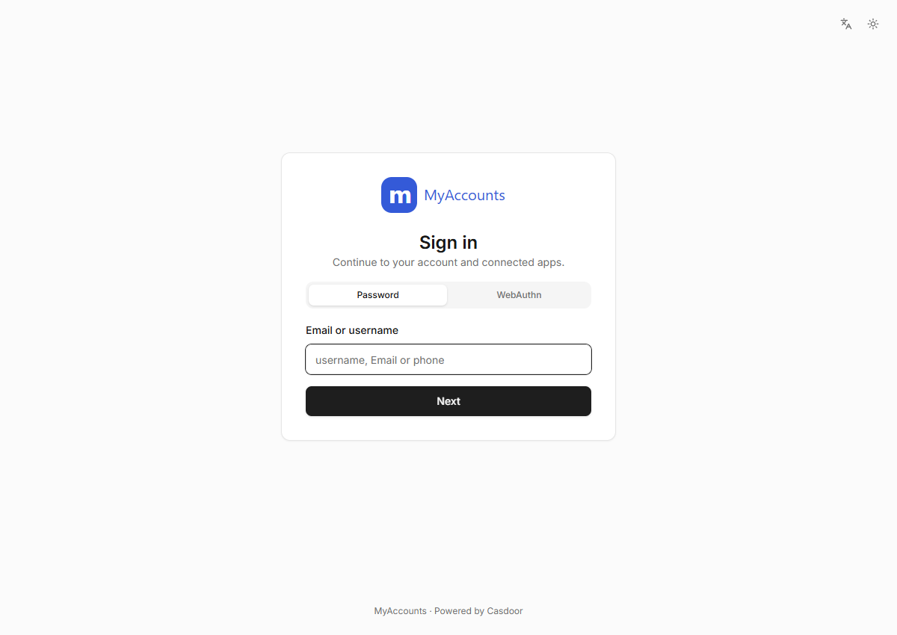
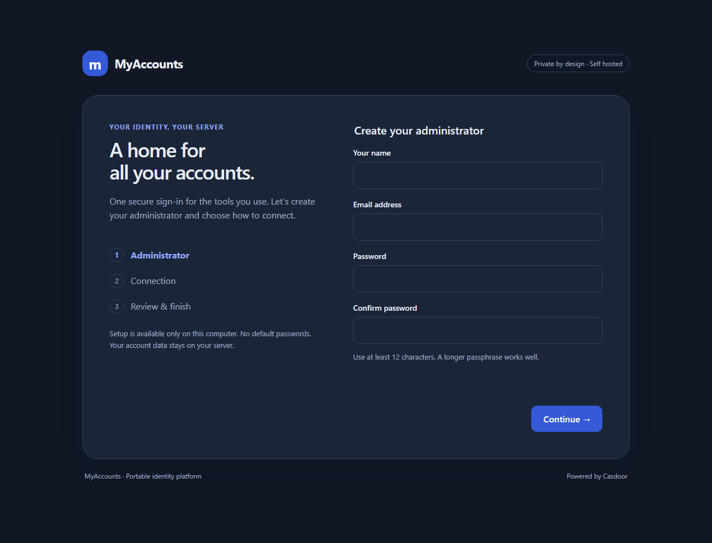
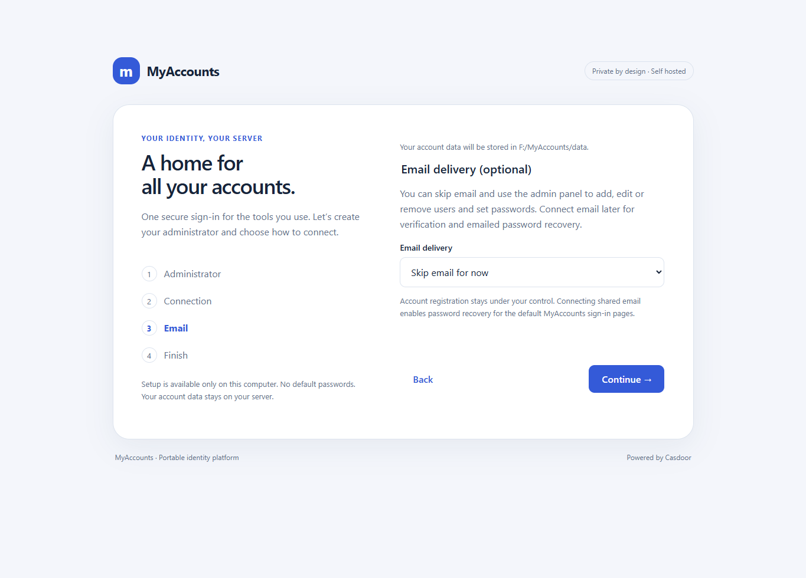
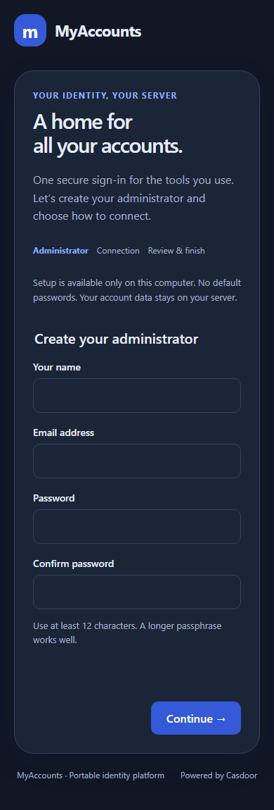
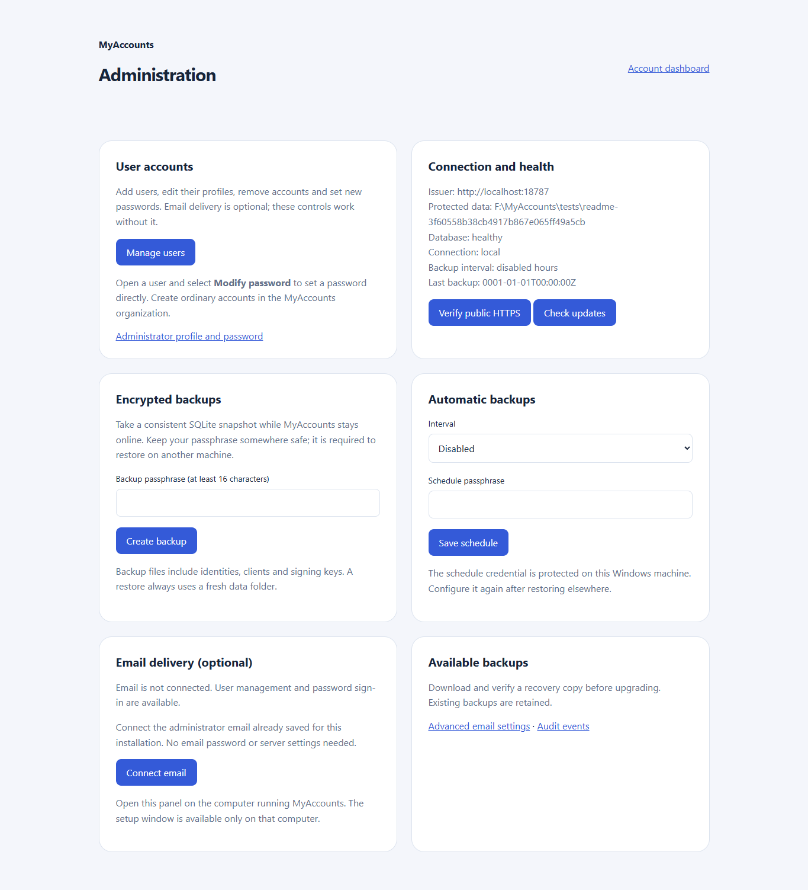
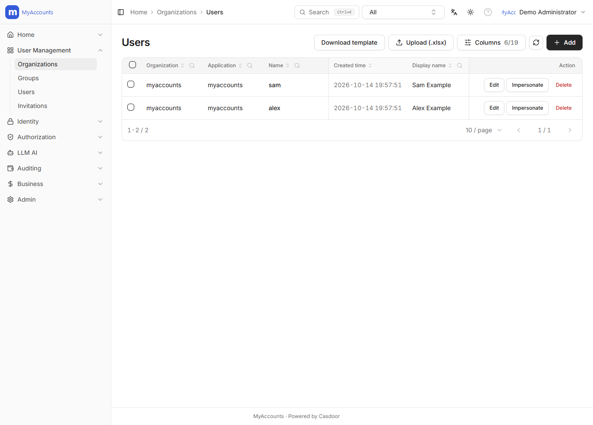
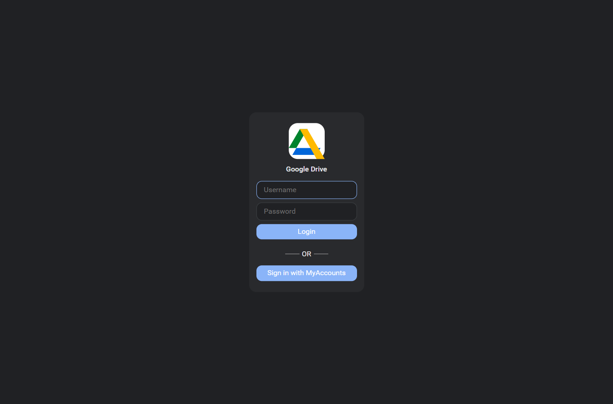
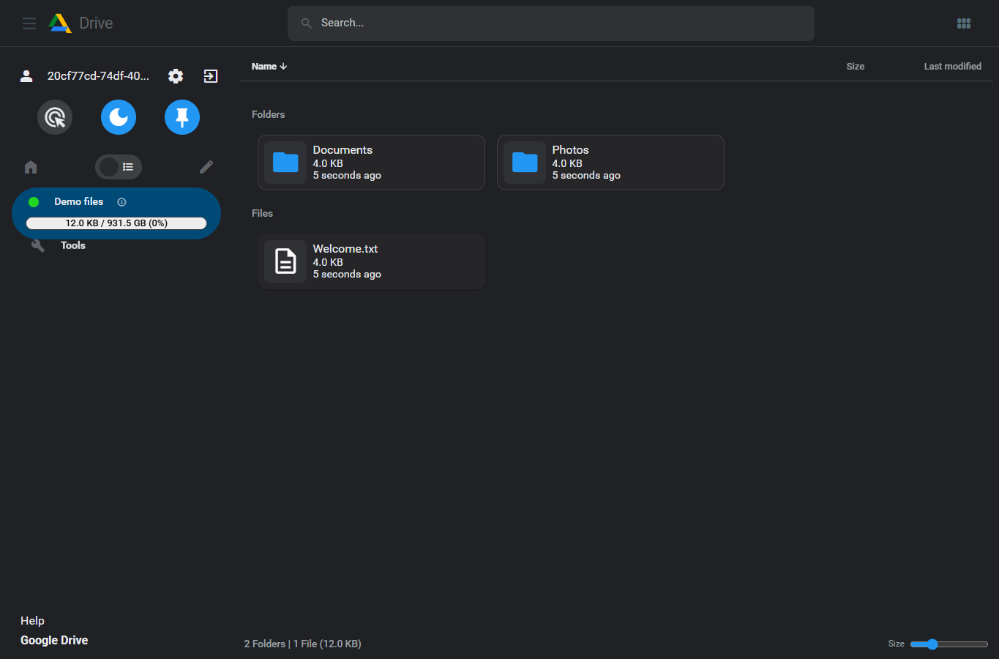

#  MyAccounts

A portable, self-hosted account server for Windows. Give your apps a shared sign-in,
manage users in one admin panel, and keep your identities on your own machine.
Powered by Casdoor, with an embedded web UI and SQLite database.

[Download Windows preview](https://github.com/oneworkspacestudio/myaccounts/releases) ·
[Custom FileBrowser](https://github.com/oneworkspacestudio/drive) ·
[Integration guide](docs/integrations.md) · [Setup and recovery](docs/deployment.md)



**Evaluation preview:** some production acceptance checks remain open. See
[verified checks and limitations](docs/acceptance.md). Public Windows preview downloads are available from the organization repository.

## What it does

- **Manage accounts:** add, edit and delete ordinary users; set or change their
  passwords directly. These actions work without an email service.
- **Share sign-in:** connect applications using OpenID Connect (OIDC), with
  authorization code flow, PKCE, stable user IDs and signing-key discovery.
- **Protect sign-in:** passwords, authenticator MFA, recovery codes and passkeys;
  session controls and optional MFA policy for selected groups.
- **Choose your connection:** local-only use, your own HTTPS domain, a manual
  reverse proxy, or a Cloudflare Tunnel configured during setup.
- **Recover and maintain:** encrypted backups, schedules, signing keys and an
  administration page for server health and recovery.
- **Optional email:** skip it entirely, connect to a configured shared email
  service using an emailed code, or use your own provider in advanced settings.

## Download and run

Download from [preview-20261014.2](https://github.com/oneworkspacestudio/myaccounts/releases).
The release contains:

| File | Who needs it |
| --- | --- |
| `MyAccounts-windows-amd64.exe` | The account server. This is the main download. |
| `MyAccounts-Mail-windows-amd64.exe` | Optional: the operator of a shared email service. Ordinary installations do not need it. |
| `SHA256SUMS.txt` | SHA-256 checksums for both executables. |
| `SBOM.cdx.json`, `LICENSE`, `NOTICE`, `KNOWN-LIMITATIONS.md`, `release-acceptance.json` | Dependency, licensing and acceptance information. |

No Docker, Go, Node, Python, Java or separate database server is required to run
MyAccounts. Cloudflare's optional connector is downloaded separately.

1. Verify the main executable against `SHA256SUMS.txt`:

   ```powershell
   Get-FileHash .\MyAccounts-windows-amd64.exe -Algorithm SHA256
   ```

2. Double-click the executable, or choose a data location explicitly:

   ```powershell
   .\MyAccounts-windows-amd64.exe -data F:\MyAccounts\data
   ```

3. In the local setup wizard, create your administrator using your own password.
   Choose **Local only** initially, or enter your domain and preferred Cloudflare
   or proxy connection. Public deployments need a stable HTTPS issuer.
4. Leave **Skip email for now** selected unless you want email delivery. No sender
   account, SMTP password or email service is needed to manage users and passwords.
5. Select automatic Windows startup if wanted; that option requests administrator
   permission. Finish setup and sign in with the administrator email.



The default local address is `http://localhost:8788`. Data normally goes in `data/`
beside the EXE. Use `-data`, `MYACCOUNTS_DATA`, or the interactive folder picker to
choose another location. Live identity data requires **NTFS** permissions; exFAT
and FAT32 are not supported for it. The executable/source can be kept on another
drive. Setup is available only on the computer running the executable.

### Email is optional

MyAccounts defaults to **Skip email for now**. Administrators can still create
accounts, edit profiles, remove users and set new passwords. Without email,
emailed verification and emailed password recovery are unavailable.

To use shared delivery, its operator must first configure the separate mail
service. Ordinary installations then verify their administrator address using a
six-digit code; they do not enter a sending-account password. The default shared
endpoint is not a promise of an already active hosted service. The service owner
can also skip setup. Cloudflare tunnelling works independently of email.
See the [shared email and owner setup guide](docs/shared-email.md).

<details>
<summary>Optional email step and mobile setup</summary>





</details>

## Administer users

Sign in as a global administrator and open **MyAccounts server** in the menu, or
visit `/operations`. The **Administration** page has a **Manage users** link.



- **Add:** open the new-user form, enter a username, display name, email and an
  initial password, then save. An administrator-created account can sign in
  without first verifying its email.
- **Edit:** open a user, change their profile details and save.
- **Change password:** select **Modify password...** or **Set password...** on the
  user, enter and confirm the new password. The administrator does not need the
  user's old password or an email code. A reset revokes MyAccounts sessions.
- **Remove:** delete the account from the user list. The built-in administrator
  and your own account are protected from deletion in that list.

Create ordinary users in the **MyAccounts** organization. Keep **built-in** for
administrators: it is the identity engine's global-administrator realm.
The ordinary-user sign-in page is `/login/myaccounts`. Public signup stays off
until an administrator deliberately enables it.

<details>
<summary>Account list screenshot</summary>



</details>

## Connect our custom FileBrowser

Our companion project is [fahimc/filebrowser](https://github.com/oneworkspacestudio/drive).
Use its [Drive/Office branch](https://github.com/oneworkspacestudio/drive)
and [Windows Drive/Office release](https://github.com/oneworkspacestudio/drive/releases).
It combines the Drive-style file interface with browser document editing and
version history. MyAccounts adds shared sign-in; FileBrowser continues to store
and authorize access to your files.



The flow is: **FileBrowser → MyAccounts sign-in → FileBrowser callback → your files**.
FileBrowser receives an OIDC identity, not the user's MyAccounts password.
It remains usable with its own password login when MyAccounts integration is off.
Keep that administrator login available for recovery.

1. In MyAccounts **Applications**, create a separate application for FileBrowser,
   assigned to the ordinary **MyAccounts** organization. Use authorization code
   flow and retain the generated client ID and secret.
2. Register the exact callback, for example
   `https://files.example.com/api/auth/oidc/callback`. For a `/files` base path,
   use `https://files.example.com/files/api/auth/oidc/callback`. Local and remote
   instances should have separate clients and their own exact callbacks.
3. Merge the following settings into the existing FileBrowser configuration;
   preserve its database, sources, Office and history settings:

   ```yaml
   frontend:
     oidcLoginButtonText: Sign in with MyAccounts
   auth:
     methods:
       noauth: false
       password:
         enabled: true
         signup: false
       oidc:
         enabled: true
         clientId: YOUR_FILEBROWSER_CLIENT_ID
         issuerUrl: https://login.example.com
         scopes: openid profile email
         userIdentifier: sub
         disableVerifyTLS: false
   ```

4. Supply the secret through `FILEBROWSER_OIDC_CLIENT_SECRET` in the FileBrowser
   process environment, using protected local configuration rather than Git.
   Restart FileBrowser and choose **Sign in with MyAccounts**.
5. Assign intended source access in FileBrowser. New SSO users should be ordinary
   users; authenticating successfully does not grant administrator rights or
   access to every source.

Behind a trusted reverse proxy/tunnel, the custom v2-based build uses
`http.trustProxyHeaders: true`; restrict direct access to that origin. Callback
addresses are derived from the browser-facing request, so forwarded scheme/host
must be correct. Follow the [complete FileBrowser setup and troubleshooting guide](docs/filebrowser.md).



The custom v0.4.0 executable passed actual browser redirects, callback/token
exchange, stable user linkage and normal-user permissions. Both configured local
and remote previews were also tested. README pictures use disposable sample
accounts/files; they do not expose a live installation's users or documents.

## Integrate other applications

For an app with **OpenID Connect**, **OIDC** or **Generic OAuth/OIDC** settings,
register a new MyAccounts application and enter:

| Application setting | Value |
| --- | --- |
| Issuer / provider URL | Your stable MyAccounts URL, e.g. `https://login.example.com` |
| Discovery / metadata URL | `https://login.example.com/.well-known/openid-configuration` |
| Client ID | The ID from that application's MyAccounts registration |
| Client secret | That application's generated secret, kept on its server |
| Callback / redirect URI | The exact address supplied by the application |
| Flow | Authorization code; PKCE S256 where supported |
| Scopes | `openid profile email` |
| User identity key | `sub` (stable ID), rather than an editable email address |

Use discovery for authorization/token/UserInfo/JWKS endpoints. A server-side OIDC
library should validate issuer, signature, audience, state, nonce and PKCE rather
than implementing token verification from scratch. Each app still controls its own
roles, permissions, sessions and logout behavior. Deleting or resetting an account
at the issuer does not guarantee immediate removal of a separate app's local cookie.

- **Gitea:** configure an OAuth2 authentication source with the OpenID Connect
  provider and discovery URL. The usual callback is
  `https://git.example.com/user/oauth2/myaccounts/callback` when the source is
  named `myaccounts`; use Gitea's actual public root URL.
- **Your own Node or Python app:** runnable examples using `openid-client` and
  Flask/Authlib are in [examples/](examples/README.md). They demonstrate login,
  verified identity and local sign-out with separate client registrations.
- **Apps without OIDC:** a compatible forward-auth/reverse-proxy integration may
  be possible, but requires separate application-specific configuration and testing.
  MyAccounts does not automatically add SSO to every app.

See [integration details, group claims, key rotation and account linking](docs/integrations.md).

## Build, test and operate

Build-time toolchain: Go 1.27.2, Node 26.8.2, Yarn 1.22.22. These are not runtime
requirements. Go modules and frontend dependencies are pinned in the lockfiles.
Build the frontend before compiling the embedded executable:

```powershell
.\scripts\build.ps1 -Version dev
```

The release workflow type-checks/builds the UI, tests native components, exercises
OIDC/MFA/passkeys/consent/recovery/backups, tests administration with email disabled,
scans dependencies, generates an SBOM and verifies uploaded executable checksums
before publishing. Tagged Actions results are the authoritative release evidence.
Known incomplete checks remain recorded in the [acceptance ledger](docs/acceptance.md).

Screenshots can be regenerated against a disposable NTFS fixture with
`scripts/smoke.ps1 -Exe PATH_TO_EXE -Root F:\MyAccounts\fresh-docs-data -OIDC -Checks docs`;
set `MYACCOUNTS_FILEBROWSER_EXE` to the custom FileBrowser executable for its screenshots.
This development-only capture needs `integration/` dependencies and Chrome.

Read [deployment/recovery](docs/deployment.md), [architecture](docs/architecture.md),
[security policy](SECURITY.md) and [contributing](CONTRIBUTING.md).
The original [project brief](MyAccounts-Codex-Project-Plan.md) is preserved verbatim.

Apache-2.0. Upstream notices are retained. MyAccounts is an independent derivative
of Casdoor and is not affiliated with Google.
